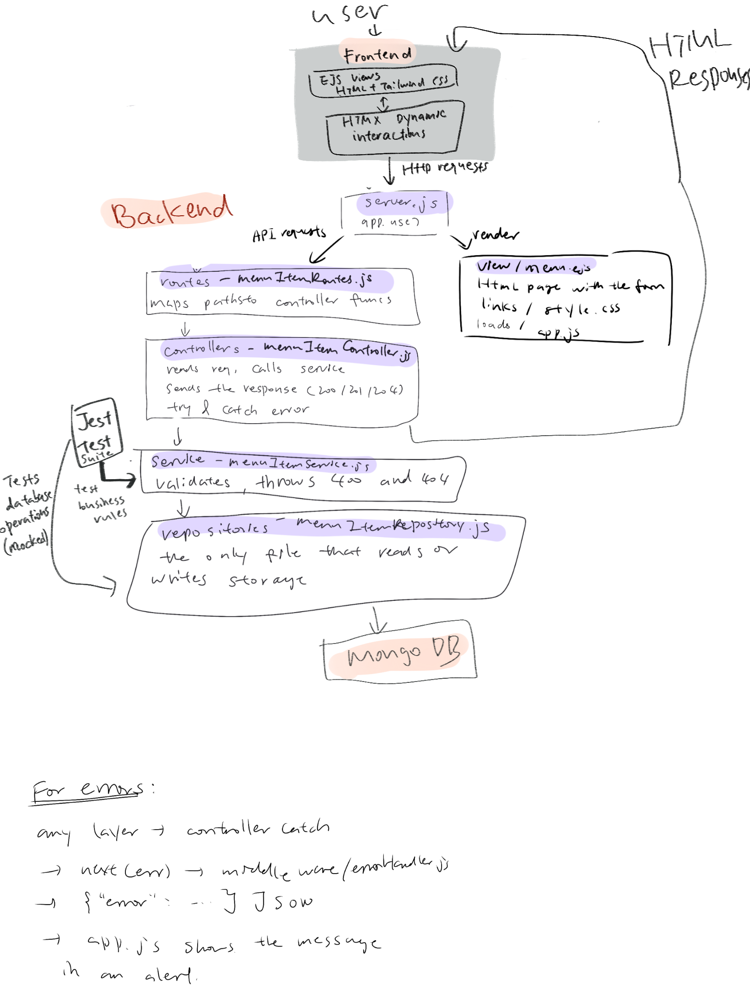
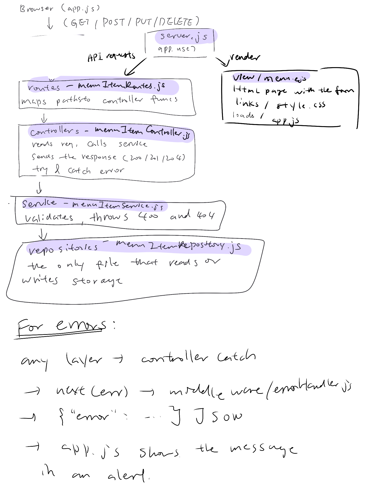

# UMass Dining Hall Tracker

A web app for tracking dining hall menu items across campus.

## Setup Instructions:

```bash
gh repo clone timdrichards/cargo
(follows the instruction in readme to setup the coding environment, including opening dev container and change .env.example to .env)
cd work
gh repo clone sunnyxie29/UMass_Dining_Hall_Tracker
cd UMass_Dining_Hall_Tracker
npm install
npm start
```

Then open http://localhost:3000
Requires Node.js.

| Name          | Github      |
| ------------- | ----------- |
| Sunny Xie     | sunnyxie29  |
| Thomas Draghi | umassmilker |
| Mark Kulmizev | mkulmizev   |

## SPRINT 3:

### HTMX Interaction

The menu page no longer builds its list with hand-written `fetch` calls and DOM updates. `public/app.js` is deleted. Adding, editing, and deleting items are all done with HTMX (`hx-*` attributes in the markup), and the server answers each request with an HTML fragment that HTMX swaps into the page. HTMX is loaded from a CDN, so there is nothing extra to install.

How to see it: run `npm start`, open `http://localhost:3000/menu`, and use the page. Nothing reloads. In the browser's Network tab, each action is a request answered with HTML rather than JSON.

| Action        | Element                 | Attributes                                                            | Server response                                  |
| ------------- | ----------------------- | --------------------------------------------------------------------- | ------------------------------------------------ |
| Load the list | `<ul id="items">`       | `hx-get="/menu-items" hx-trigger="load"`                              | `partials/menu-items.ejs`, one row per item      |
| Add           | `#item-form`            | `hx-post="/menu-items" hx-target="#items"`                            | The refreshed list (201)                         |
| Edit          | the row's inline form   | `hx-put="/menu-items/:id" hx-target="closest li" hx-swap="outerHTML"` | The single updated row, `partials/menu-item.ejs` |
| Delete        | the row's Delete button | `hx-delete="/menu-items/:id" hx-target="#items" hx-confirm`           | The refreshed list                               |
| Show an error | `#form-error`           | `HX-Retarget` and `HX-Reswap` response headers                        | The error message as text (400, 404)             |

How it works with the existing layers:

- The HTMX work changes the controller, the error handler, the views, and `server.js`. The routes and the service are not changed by it. The controller checks for the `HX-Request: true` header that HTMX sends: if it is there, the controller renders a partial, and if it is not, it returns JSON with the same status codes as before.
- Errors from the service go through the same error handler. For an HTMX request it renders `partials/error.ejs` and tells HTMX to put it in `#form-error` instead of the list, so a failed save shows its message in the page and leaves the list alone.
- Every successful list or row response also carries an out-of-band element that empties `#form-error`, so an old error disappears after the next successful action.
- The dining hall dropdown options are rendered by the server from the DTO's `DINING_HALLS`, so the hall list no longer has a second copy in client-side JavaScript.

Client-facing id that assumed an array position: the old `app.js` stored each row's id as its position in the list (`li.dataset.id = list.children.length`) and re-numbered every row after a delete, because the ids the server understood were array positions. Now the server renders each row's id into its `hx-put` and `hx-delete` URLs, and add and delete respond with the whole refreshed list, so nothing on the client has to track a position. The controller uses the item's `id`, then its `_id`, and only falls back to the array position when neither exists, so the views use the real MongoDB id once the repository returns it.

### Tests

Run them with:

```bash
npm install
npm test
```

The repository and service are mocked with `jest.unstable_mockModule`, so no files or database are touched.

| Test file                          | What it covers                                                                                                                                                                                                                                                                                            |
| ---------------------------------- | --------------------------------------------------------------------------------------------------------------------------------------------------------------------------------------------------------------------------------------------------------------------------------------------------------- |
| `tests/menuItemService.test.js`    | Every service rule: name required (missing, empty, whitespace), dining hall must be 1 to 4 (missing, empty, out of range, non-numeric), section required (missing, empty, whitespace). Also trimming, converting form strings like `"3"` to numbers, and the 404 for update and delete of a missing item. |
| `tests/menuItemController.test.js` | A request with `HX-Request` gets the right partial and status, a request without it still gets JSON, ids come from the item or its position, and service errors reach `next`.                                                                                                                             |
| `tests/errorHandler.test.js`       | JSON errors for plain requests, a retargeted HTML error for HTMX requests, and the generic message for a 500.                                                                                                                                                                                             |
| `tests/menuItemViews.test.js`      | The rendered partials contain the expected `hx-delete`, `hx-put`, and `hx-target` values, preselect the right hall, escape item text, and clear the error area.                                                                                                                                           |

### Restyle with Tailwind

With the implementation of Tailwind, we we're able to it make so our pages are user friendly on phone-sized screens (375 px) and not just regular sized computer screens (1280 px). When a smaller screen size is detected, the page automatically adjusts by making the interactable portions of the page (as well as the list of the dining halls on the halls page) be stacked vertically on top of each other instead of being side by side. On top of making these adjustments on smaller sized screens to make them usable, some smaller design choices were implemented. All of the buttons now appear as a different color when they are being hovered, not just the reference buttons. Besides that, most of the classes that were originally in the public.css stylesheet were just transferred over into the ejs files for each page, besides the ones that were related to the functions of app.js.

### MongoDB Integration

Replaced the previous JSON file-based data storage with MongoDB using Mongoose. The repository layer now communicates with MongoDB to perform CRUD operations on menu items.

How to see it:

- Start the MongoDB database.
- Run the application using `npm start`.
- Open the application and create, update, or delete a menu item.
- The changes are saved in MongoDB and persist after restarting the application.

### System Diagram



### Design Decisions:

Sunny Xie:
We decided to use Mongoose to migrate our data from JSON files to MongoDB. Another option would have been to continue storing data in JSON files and manually manage updates to those files. We chose MongoDB because it offers more automatically generated IDs and built-in database operations. This will make it easier to add search functionality in the future, and editing or deleting individual menu items will no longer require renumbering. Additionally, this change can be implemented quickly because we previously organized the backend code into layers, so we no longer need to rewrite the entire backend.

We also decided to use Jest to test the service layer and to mock the repository during unit testing instead of connecting to a MongoDB database. Another option would have been to run tests against the actual database. We chose to mock the repository because this allows us to test business logic and validation rules independently of database operations. Tests run faster and do not depend on existing data.

Mark Kulmizev:
One decision we had to make when going about the tailwind implementation was reformatting the pages to make the process of handling the sm breakpoints easier. In the unit 15 code, the links to go to the other pages are just text and are in the header. In our approach, they are buttons located at the bottom of the page. By switching to this kind of format, the implementation of how we handle the sm breakpoints would be much easier since we could then just write similar code to what we have learned through the notes app. Reformatting in this way would also make our page look a bit cleaner/less cluttered, since it would free up some space at the bottom by removing the buttons, but this isn't significant since the pages already aren't cluttered. We decided to stick with our approach with the buttons, as we believe that it is more user friendly. Some users may find that buttons are more recognizable as something that can be interacted with rather than text, so we chose to stick with what we had. If we switched to the format where the links to the other pages were just text next to the title, some users would possibly not recognize that the lines of text can be interacted with to navigate to the other pages. Even if we turned the text into buttons next to the title, it wouldn't look as neat compared to our final approach, as the buttons would be on a maroon background instead of a white one, which would make them pop out less.

Thomas Draghi:
For the HTMX conversion, we decided that adding or deleting an item makes the server send back the whole refreshed list, while editing an item sends back only the one updated row. We decided this because our item ids started out as positions in the list, so after a delete every row below it moves up one place, and a page that only removed one row would be left with stale ids in the Edit and Delete buttons of the rows after it. Rebuilding the list from the server means every id on the page is correct after each action, and it let me delete the `renumber` code that `app.js` needed. The alternative of returning only the new row on add and an empty response on delete can still be considered valid though, as it sends less HTML and leaves the rest of the page alone, which would matter for a very long list. Therefore, we sacrifice that smaller response in order to keep the client from ever tracking ids itself, as the menu is short enough that re-rendering it costs very little. Now that the ids are real MongoDB ids, the one-row version would also be safe, so it would be the better choice if the list grew large.

## SPRINT 2:

### Feature: Menu Items

#### What it does

Users can add dining hall menu items, view them in a list, edit them, and delete them. Each item has three fields (this feature was designed for admins, common users will only have access to the view version):

| Field          | Description                                                    | Rules                     |
| -------------- | -------------------------------------------------------------- | ------------------------- |
| `name`         | Name of the dish                                               | Required, cannot be blank |
| `diningHallId` | Dining hall: 1 Worcester, 2 Franklin, 3 Berkshire, 4 Hampshire | Must be one of 1 to 4     |
| `section`      | Menu section, such as Breakfast or Grill                       | Required, cannot be blank |

Items are saved in `data/menu-items.json`, so they are still there after the server restarts.

#### How to try it

1. Follow the setup instructions at the top of this page.
2. Then, run this command in your terminal: `npm start`.
3. Open `http://localhost:3000` in your browser.
4. Use the traversal buttons at the bottom of each page to go between each page (home page, halls page, and menu page).
5. On the menu page, you may add, edit, and delete food items freely.

#### Routes

| Method | Path            | Purpose                                         | Success | Errors                           |
| ------ | --------------- | ----------------------------------------------- | ------- | -------------------------------- |
| GET    | /menu-items     | List all items                                  | 200     |                                  |
| POST   | /menu-items     | Add an item                                     | 201     | 400 invalid input                |
| PUT    | /menu-items/:id | Update an item (id is its position in the list) | 200     | 400 invalid input, 404 not found |
| DELETE | /menu-items/:id | Delete an item                                  | 204     | 404 not found                    |

All errors are returned as JSON in the form `{ "error": "message" }`, and the page shows the message to the user.

#### System Diagram



#### Design Decisions

Sunny Xie:
We’ve designed the repository to be the sole component that reads from and writes to the `data/menu-items.json` file, rather than having the service call `fs` directly. An alternative approach could reduce the number of files: the service reads the file, applies rules, and then writes it back. While this approach works for JSON files, it blurs the distinction between service rules and the location where data is stored. If our team were to migrate to MongoDB in the future, not only would the storage code need to be rewritten, but the server-side code would also have to be rewritten, and we would be unable to test and validate the rules without access to the actual files. With the repository boundary design, however, when the storage method changes, only that file changes, while the server-side code remains unchanged. The cost is one additional file and one extra function call per operation, but I believe this cost is negligible compared to the flexibility we gain.

Thomas Draghi: For our menu item DTO and app.js, we decided to represent each dining hall as a numeric id instead of its name. The DTO holds a list of { id, name } pairs, and the dropdown shows the names but sends the ids. We decided this because if the item stored the hall’s name, a renamed hall would leave every saved item pointing at a name that no longer exists, while an id keeps pointing at the right hall. The alternative of storing the name can still be considered valid though, as it needs no lookup, has no “Unknown hall” case, and the saved data is readable on its own. Therefore, we sacrifice that simplicity in order to keep items tied to the correct hall, as the extra lookup is small and the hall list only needs to be kept in sync in two places.

Mark Kumizev:
For our menu.ejs template, we decided to make each item's dining hall and section values appear less significant (did this by making the font smaller, made the text more gray) as compared to the actual name of the dish. We decided to do this because if the items' every field had the same styling the list, the items would basically appear as just being sentences (for example: Chicken Tenders Worcester Lunch). Therefore, in an effort to present each item in a more clean way, we went down this route. The alternative of keeping the styling the same across all fields can still be considered as being valid though, as all the fields carry important information and we don't wanna give an impression that this isn't the case. Therefore, we sacrifice this way of preventing that misconception in order to present the items in a more clean way, as it should already be obvious that all fields carry important information.

## SPRINT 0 & 1:

Working Agreement:

1. We will communicate via the iMessage group chat that we created.

2. "Done" means that the code properly functions without throwing errors and doesn't conflict with other files (naming semantics, inputs/outputs match, etc). It doesn't even have to be 100% completed, just work as you go and commit what is needed.

3. Disagreements will be solved by kindly talking with other group members and calmly explaining what is wrong.

Project Domain:
We want to make a dining hall tracker similar to the official UMass one. This directly benefits everyone by being able to use our computers to check the dining halls (how busy they are currently, the day's menu, etc.) rather than our phones. While the phone does have some upsides, sometimes using your phone just isn't an option. So, we want to create this website to help those who need it. Beyond the classroom, it just overall helps the student body by creating a more convenient way to check the dining hall statuses.

Git clone the repository to your own computer in a container to be used. this project is a tracker made to be a web version of the UMass dining hall app on students phones. it will display food items and hours for specific dining halls to a users wishes. to run it, cd into the repository, run npm install ejs in your terminal, and then run npm start to start the server locally for you to access in your browser.
