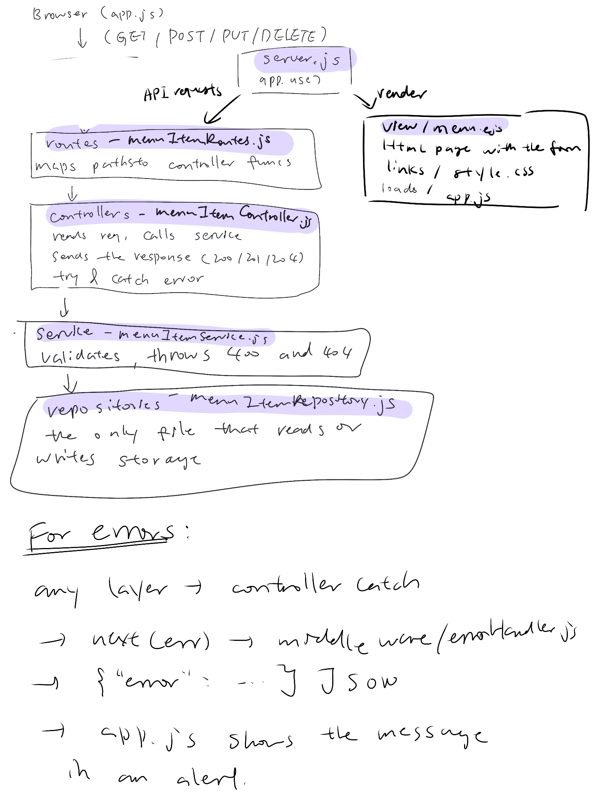

# UMass Dining Hall Tracker

A web app for tracking dining hall menu items across campus.

```bash
gh repo clone sunnyxie29/UMass_Dining_Hall_Tracker
cd UMass_Dining_Hall_Tracker
npm install
npm install express
npm install ejs
node server.js
```

Then open http://localhost:3000
Requires Node.js.

| Name          | Github      |
| ------------- | ----------- |
| Sunny Xie     | sunnyxie29  |
| Thomas Draghi | umassmilker |
| Mark Kulmizev | mkulmizev   |

Working Agreement:

1. We will communicate via the iMessage group chat that we created.

2. "Done" means that the code properly functions without throwing errors and doesn't conflict with other files (naming semantics, inputs/outputs match, etc). It doesn't even have to be 100% completed, just work as you go and commit what is needed.

3. Disagreements will be solved by kindly talking with other group members and calmly explaining what is wrong.

Project Domain:
We want to make a dining hall tracker similar to the official UMass one. This directly benefits everyone by being able to use our computers to check the dining halls (how busy they are currently, the day's menu, etc.) rather than our phones. While the phone does have some upsides, sometimes using your phone just isn't an option. So, we want to create this website to help those who need it. Beyond the classroom, it just overall helps the student body by creating a more convenient way to check the dining hall statuses.

Git clone the repository to your own computer in a container to be used. this project is a tracker made to be a web version of the UMass dining hall app on students phones. it will display food items and hours for specific dining halls to a users wishes. to run it, cd into the repository, run npm install ejs in your terminal, and then run npm start to start the server locally for you to access in your browser.

## Feature: Menu Items

### What it does

Users can add dining hall menu items, view them in a list, edit them, and delete them. Each item has three fields (this feature was designed for admins, common users will only have access to the view version):

| Field          | Description                                                    | Rules                     |
| -------------- | -------------------------------------------------------------- | ------------------------- |
| `name`         | Name of the dish                                               | Required, cannot be blank |
| `diningHallId` | Dining hall: 1 Worcester, 2 Franklin, 3 Berkshire, 4 Hampshire | Must be one of 1 to 4     |
| `section`      | Menu section, such as Breakfast or Grill                       | Required, cannot be blank |

Items are saved in `data/menu-items.json`, so they are still there after the server restarts.

### How to try it

1. After cloning the repository, cd into it and run the following command in your terminal: `npm install ejs`
2. Then, run this command in your terminal: `npm start`
3. Open `http://localhost:3000` in your browser.
4. Use the traversal buttons at the bottom of each page to go between each page (home page, halls page, and menu page).
5. On the menu page, you may add, edit, and delete food items freely.

### Routes

| Method | Path            | Purpose                                         | Success | Errors                           |
| ------ | --------------- | ----------------------------------------------- | ------- | -------------------------------- |
| GET    | /menu-items     | List all items                                  | 200     |                                  |
| POST   | /menu-items     | Add an item                                     | 201     | 400 invalid input                |
| PUT    | /menu-items/:id | Update an item (id is its position in the list) | 200     | 400 invalid input, 404 not found |
| DELETE | /menu-items/:id | Delete an item                                  | 204     | 404 not found                    |

All errors are returned as JSON in the form `{ "error": "message" }`, and the page shows the message to the user.

### System Diagram



### Design Decisions

Sunny Xie:
We’ve designed the repository to be the sole component that reads from and writes to the `data/menu-items.json` file, rather than having the service call `fs` directly. An alternative approach could reduce the number of files: the service reads the file, applies rules, and then writes it back. While this approach works for JSON files, it blurs the distinction between service rules and the location where data is stored. If our team were to migrate to MongoDB in the future, not only would the storage code need to be rewritten, but the server-side code would also have to be rewritten, and we would be unable to test and validate the rules without access to the actual files. With the repository boundary design, however, when the storage method changes, only that file changes, while the server-side code remains unchanged. The cost is one additional file and one extra function call per operation, but I believe this cost is negligible compared to the flexibility we gain.

Thomas Draghi:

Mark Kumizev:
For our menu.ejs template, we decided to make each item's dining hall and section values appear less significant (did this by making the font smaller, made the text more gray) as compared to the actual name of the dish. We decided to do this because if the items' every field had the same styling the list, the items would basically appear as just being sentences (for example: Chicken Tenders Worcester Lunch). Therefore, in an effort to present each item in a more clean way, we went down this route. The alternative of keeping the styling the same across all fields can still be considered as being valid though, as all the fields carry important information and we don't wanna give an impression that this isn't the case. Therefore, we sacrifice this way of preventing that misconception in order to present the items in a more clean way, as it should already be obvious that all fields carry important information.
